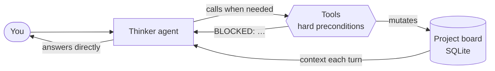

<div align="center">


# MyThinking

### A stateful AI thinking partner that takes a raw idea to a decision.

<a href="LICENSE"></a>

<a href="https://langchain-ai.github.io/langgraph/"></a>
<a href="https://docs.astral.sh/uv/"></a>
<a href="https://github.com/astral-sh/ruff"></a>

[Quickstart](#quickstart) · [How it works](#how-it-works) · [Evals](#behavioral-evals) · [HTTP API](#http-api) · [Contributing](#contributing)

</div>

---

MyThinking helps you take a raw idea and work it through to a decision or a next
experiment. It clarifies the goal, surfaces assumptions and gaps, explores
alternatives, gathers evidence, and keeps the through-line in view. Every project
is remembered across sessions.

It is **one conversational agent with a small set of sharp tools**, not a pipeline
of bots. It answers ordinary questions directly and reaches for a tool only when
the work calls for one. Tool selection *is* the router: there is no intent
classifier and no hand-wired workflow graph.

- 🧭 **Persistent project board.** North Star, branches, decisions, evidence, and a
  plan, stored in local SQLite and resumable across sessions.
- 🔒 **Correctness in code, not prompts.** Every board-mutating tool checks a hard
  precondition and fails safe with `BLOCKED: …`.
- 🔎 **Agentic research.** Web search, page fetch, and PDF ingestion with
  verbatim citation tags. Sources only become evidence when saved explicitly.
- 🖥️ **CLI, HTTP API, and web UI.** A streaming FastAPI server and a Next.js
  workspace.
- 🧪 **Behavioral evals.** 63 cases with deterministic trace checks plus
  LLM-judged expectations. Also published as a Hugging Face dataset.

## Quickstart

**Requirements:** Python 3.11+, [uv](https://docs.astral.sh/uv/), and an
[OpenRouter API key](https://openrouter.ai/settings/keys).

```bash
git clone https://github.com/Amitdutta121/MyThinker.git
cd MyThinker
uv sync
cp .env.example .env          # PowerShell: Copy-Item .env.example .env
```

Set `OPENROUTER_API_KEY` in `.env`, then:

```bash
uv run mythinking init        # create local storage
uv run mythinking status      # check configuration (no API call)
uv run mythinking chat "Help me think through a product idea."
```

Continue a project later:

```bash
uv run mythinking chat --last "Continue where I left off."
uv run mythinking chat --project-id <id> "Here is more context."
uv run mythinking list                 # recent projects
uv run mythinking show <id>            # session summary
```

The default model is OpenRouter's `~openai/gpt-latest` alias. Set
`OPENROUTER_MODEL` to any `provider/model` slug from the
[OpenRouter catalog](https://openrouter.ai/models) to pin a model.

### Web UI

```bash
uv run mythinking serve                # API on 127.0.0.1:8000
cd frontend && npm install && npm run dev
```

The UI talks to `http://127.0.0.1:8000` by default. Override it with
`NEXT_PUBLIC_API_BASE_URL` (see `frontend/.env.local.example`).

## How it works



Most agent systems are a maze of sub-agents passing messages. MyThinking makes
the opposite bet: one agent, a few sharp tools, and correctness pushed into
deterministic code rather than left to the model's judgement.

| Rule | Enforced by |
| --- | --- |
| A **North Star** must exist before exploration begins | `explore_ideas`, `converge_ideas` |
| Convergence writes a **proposal**, never a commitment | `converge_ideas` |
| A commit copies the **exact proposal**, only on explicit user authorization | `commit_proposed_direction` |
| Planning requires a **committed direction** | `create_or_revise_plan` |
| Source material is **never auto-promoted** to evidence | `save_evidence` (source-support + relevance check) |
| User-added plan steps **survive re-planning** and direction changes | `create_or_revise_plan` |

Framing, exploring, converging, and planning are **structured-output engines**
invoked *inside* those tools, not separate agents in a conversation. The
architecture was validated end to end in [`notebooks/`](notebooks/) before the
single-agent pivot.

Each turn: load board → run the agent (tools enforce preconditions and mutate the
board) → derive display mode → persist → return an `AssistantTurn`.

### Tools

| Group | Tools |
| --- | --- |
| **Thinking** (mutate the board, precondition-gated) | `set_north_star` · `explore_ideas` · `converge_ideas` · `commit_proposed_direction` · `record_user_decision` · `create_or_revise_plan` · `park_branch` · `save_evidence` |
| **Lookups** (read-only, pulled on demand) | `get_project_snapshot` · `get_evidence_ledger` · `get_open_research_tasks` · `get_branch_alternatives` · `get_next_actions_plan` |
| **Documents** | `ingest_pdf` · `list_indexed_documents` · `search_documents` |
| **Web** | `web_search` · `fetch_url` |

### Research and evidence

The agent always has `web_search` and `fetch_url` and decides for itself when it
needs them. Fetched pages and ingested PDFs are **source material**. They become
project evidence only through an explicit `save_evidence` call that passes a
source-support and project-relevance check. `search_documents` returns passages
under citation tags (`[[file.pdf p.3]]`, `[[Title]]`), and the system prompt
requires those tags verbatim in document-grounded answers.

`web_search` uses keyless DuckDuckGo by default. Set
`MYTHINKING_RESEARCH_RETRIEVER=tavily` and `TAVILY_API_KEY` to use Tavily instead.

<details>
<summary><b>Configuration reference</b></summary>

All settings live in `.env` (see [`.env.example`](.env.example)).

| Variable | Default | Purpose |
| --- | --- | --- |
| `OPENROUTER_API_KEY` | — | Required for any model call |
| `OPENROUTER_MODEL` | `~openai/gpt-latest` | Chat model slug |
| `MYTHINKING_DATA_DIR` | `data` | Where the SQLite stores live |
| `MYTHINKING_RESEARCH_RETRIEVER` | DuckDuckGo | Set to `tavily` (with `TAVILY_API_KEY`) |
| `MYTHINKING_EMBEDDING_MODEL` | `openai/text-embedding-3-small` | Retrieval embeddings, via the same OpenRouter key |
| `MYTHINKING_CONTEXT_RETRIEVAL_THRESHOLD` | `20` | Board size above which project state is retrieved, not inlined |
| `MYTHINKING_ENABLE_PROFILE_EXTRACTION` | off | Cross-project profile (role, expertise, working style; never sensitive details). Inspect with `uv run mythinking profile` |
| `MYTHINKING_MLFLOW_*` | off | Optional tracing. Needs `uv sync --group observability` |

Storage: chat threads in `data/checkpoints.sqlite`, the board in
`data/state.sqlite`, fetched and ingested documents in `data/store.sqlite`.

</details>

## HTTP API

```bash
uv run mythinking serve       # binds 127.0.0.1:8000
```

`POST /turns/stream` emits one Server-Sent Event per tool the agent runs
(`{"type": "node", "node": "<tool>"}`), then a final `{"type": "turn", ...}`. A
failure mid-stream arrives as a terminal `{"type": "error", ...}` event, not a
dropped connection.

<details>
<summary><b>Endpoint reference</b></summary>

```text
GET    /health                                   liveness check
POST   /turns                                    {"message": "...", "project_id": "..."} -> AssistantTurn
POST   /turns/stream                             same body -> text/event-stream of TurnStreamEvent frames
GET    /projects?limit=20                        recent project summaries, newest first
GET    /projects/{project_id}                    full ProjectState
GET    /projects/{project_id}/documents          indexed documents for a project

# Direct edits (no agent turn). Each returns the updated ProjectState;
# KeyError -> 404, ValueError -> 400.
PATCH  /projects/{id}/north-star                 {"title": "..."}
POST   /projects/{id}/decisions                  {"choice": "...", "question?": "...", "rationale?": "...", "reversible?": true}
PATCH  /projects/{id}/decisions/{decision_id}    partial of the same fields
DELETE /projects/{id}/decisions/{decision_id}
POST   /projects/{id}/proposal/approve           commit the pending proposal verbatim
DELETE /projects/{id}/proposal                   dismiss the pending proposal
POST   /projects/{id}/next-actions               {"description": "...", "time_box_minutes?": 30}  (origin="user")
PATCH  /projects/{id}/next-actions/{action_id}   partial; also toggles completed
DELETE /projects/{id}/next-actions/{action_id}
```

CORS is open for the local Next.js dev server (`localhost` / `127.0.0.1`, ports
`3000` and `3001`).

</details>

## Behavioral evals

[`evals/cases.jsonl`](evals/cases.jsonl) holds **63 cases across 15 categories**,
including state integrity, convergence quality, unsupported invention, framing,
branch navigation, and scoped research. Each case gives one or more user turns,
optional seeded project state, deterministic `check`s on the tool trace and board
delta, and natural-language `expectations` for an LLM judge. The full schema is
documented at the top of [`evals/runner.py`](evals/runner.py).

> [!WARNING]
> The runner makes **live model calls**. Run it deliberately, not in CI.
> `uv run pytest` only validates the case file, offline.

```bash
uv run python evals/runner.py                   # tool trace + deterministic checks
uv run python evals/runner.py --judge           # + LLM-judged expectations
uv run python evals/runner.py --only commit-exact-proposal,journey-end-to-end
```

The runner exits non-zero if any deterministic check fails.

**On Hugging Face.** The cases are also published as a dataset
([`amitdutta121/mythinking-evals`](https://huggingface.co/datasets/amitdutta121/mythinking-evals)). To rebuild and push it:

```bash
uv run python evals/export_hf.py                       # -> dist/hf-dataset/
hf upload amitdutta121/mythinking-evals dist/hf-dataset --repo-type dataset
```

## Development

```bash
uv run ruff format .
uv run ruff check .
uv run pytest                 # fully offline; no API key needed
```

<details>
<summary><b>Project layout</b></summary>

```text
src/mythinking/
  config.py       Environment and OpenRouter settings
  llm.py          The only model-construction boundary
  state.py        Typed thinking and project state (Pydantic)
  persistence.py  Project snapshots and LangGraph checkpoints
  documents.py    Full-text research documents and chunks (page-tracked for PDFs)
  retrieval.py    Typed wrapper around LangGraph's SqliteStore for semantic search
  context.py      Scoped context formatting and threshold-based retrieval
  gates.py        North Star / decision / evidence structured-output gates
  board.py        Mutable state holder, mode derivation, plan staleness, frame merge
  exploration.py  Explore/converge merge and formatting service
  planning.py     Next-action planning merge/formatting service
  evidence.py     Evidence ledger merge and citation rendering
  research.py     Research-task matching and scoped evidence-import pipeline
  profile.py      User-profile merge and prompt rendering
  tools.py        The agent's tools: precondition-gated thinking tools,
                  read-only lookups, document tools, and web tools
  agents/         Specialist structured-output engines invoked inside tools
  agent.py        The single create_agent loop + context-injection middleware
  runtime.py      Turn orchestration and persistence
  prompts.py      Versioned prompt registry
  ingest.py       File upload / ingestion
  observability.py Optional MLflow tracing (lazy import)
  summary.py      Deterministic, offline session summary rendering
  api.py          HTTP API over the runtime (non-streaming + SSE)
  cli.py          init, status, smoke-model, chat, list, show, profile, serve
prompts/          Versioned prompt specifications (YAML)
evals/            Behavioral eval cases, live runner, and HF dataset export
tests/            Deterministic unit tests
frontend/         Next.js / TypeScript workspace UI (HTTP-only)
docs/             Design notes and the implementation plan
```

</details>

## Contributing

Issues, discussion, and PRs are welcome. Read [`CONTRIBUTING.md`](CONTRIBUTING.md)
and [`AGENTS.md`](AGENTS.md) first. The two rules that matter most:

- **Do not reintroduce a multi-agent graph or an intent classifier.**
- **Keep board-mutation correctness in deterministic tool preconditions**, not in
  prompt text.

Every behavior change ships with tests. Every behavioral prompt instruction needs
an evidence entry or a `product_hypothesis` label, plus an eval case.

## License

[MIT](LICENSE) © Amit Dutta
